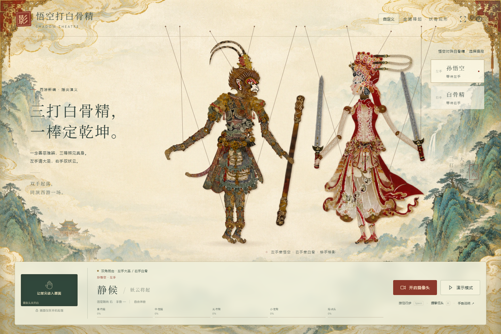

# Video-Interaction · 悟空打白骨精

可运行的传统皮影双手交互网页，演绎孙悟空大战白骨精。孙悟空位于左侧、朝右，白骨精位于右侧、朝左；左手控制悟空，右手控制白骨精，两人可独立移动和摆动肢体。参考用户提供的角色图重新制作了分节皮影素材，保留金箍棒、白骨精双剑、衣袍和脚部操纵线。右上角支持自定义文字和界面大小。



## 打开与分享

**直接使用：将整个文件夹解压后，使用 Chrome / Edge 双击 `index.html`。** 无需安装 Node.js、Python 或启动服务器。页面支持完整分节角色动画、鼠标 / 触摸 / 键盘、演示、文字编辑、界面大小，以及授权后的双手手势识别。不要在压缩包预览中直接打开，也不要单独只发送 HTML。

在 GitHub 点击 **Code → Download ZIP** 下载并完整解压，然后打开根目录的 `index.html`。仓库包含网页运行文件、40 个透明角色部件、源码和本地识别资源。`camera-data.js` 约 43 MB，点击开启摄像头后才加载；没有外部 CDN 请求。请保留该文件以及 `assets` 文件夹。

Chrome / Edge 的本地文件页面可在用户授权后使用摄像头；其他浏览器、应用内预览或单位设备政策可能限制访问。遇到限制可以改用 Chrome / Edge，或使用下列服务器方式。网页不需要关闭浏览器安全设置。[摄像头安全上下文说明](https://developer.mozilla.org/en-US/docs/Web/API/MediaDevices/getUserMedia)。

可选的本地服务器：双击 `start.bat`，或者在当前源码目录运行 `node server.mjs`，浏览器打开 `http://localhost:5173`。`start.bat` 优先使用 Node.js，找不到时尝试 Python。这个方式作为浏览器兼容备用，不是分享版的必要步骤。

## 使用

| 操作 | 角色表现 |
| --- | --- |
| 点击「开启摄像头」，允许权限 | 显示镜像预览并开始本机双手识别 |
| 左手 | 固定控制孙悟空；不按手在画面的位置分配 |
| 右手 | 固定控制白骨精；可与左手同时做不同动作 |
| 食指弯曲 / 伸直 | 独立控制人物右腿摆动 / 复位 |
| 中指弯曲 / 伸直 | 独立控制人物左腿摆动 / 复位 |
| 无名指弯曲 / 伸直 | 独立控制人物右胳膊与袖子 |
| 小拇指弯曲 / 伸直 | 独立控制人物左胳膊与袖子 |
| 大拇指弯曲 / 伸直 | 头部点头 / 抬回 |
| 四指收拢握拳 | 人物低头，张开后恢复；四肢休止 |
| 各手向画面左右移动 | 带动对应人物移动；孙悟空一直朝右，白骨精一直朝左 |
| 「演示模式」 / D 键 | 两个人物同时演出，分别移动、摆肢与低头 |
| 按住「行步」 / 空格键 | 行走，释放后渐缓至站立 |
| Q / W / E / R / T 键 | 分别控制右腿 / 左腿 / 右臂 / 左臂 / 点头 |
| 按住「握拳低头」 / B 键 | 低头，释放后恢复 |
| 方向键 | 左右移动当前手动选中的人物，朝向固定 |
| 舞台拖动 | 选中离按下位置最近的人物并移动 |
| 点按舞台 | 低头一次 |
| 点击戏角 / 1、2 键 | 选择手动操控对象；两个角色仍同时显示 |
| 右上角「自定义」 | 修改网页文字、角色名称和界面大小 |
| 自定义中的「恢复默认」 | 恢复原始文字和 100% 界面大小 |

摄像头建议使用光线充足的环境，让两只手完整进入画面，掌心朝向镜头。双手用不同颜色绘制骨架，并标明左手 / 孙悟空、右手 / 白骨精。人物卡片分别显示识别状态。模型输出中的 Left、Right 按实际手身份绑定，不使用结果顺序或画面左右位置。

每只手的五根手指按各自弯曲程度连续驱动对应人物部位。左右按人物自身定义；悟空与白骨精的朝向固定。页面底部显示当前手动选中人物的五指对应关系和读数；选择只影响手动操作和读数面板，不改变双手固定绑定。

任一只手短暂丢失会保留姿势约 430 ms，随后仅让对应人物的关节平滑恢复待机，停留在最后位置；另一只手继续正常控制。镜像位置与预览一致。手势识别运行在 Web Worker 中，动画与识别分开处理；每次仅提交一帧，最多约 20 fps。

支持桌面与手机竖屏；窄屏底部改为两行操作；放大界面时增加页面高度，可向下滚动，保证角色和操作面板有独立空间。手机可使用触摸按钮。若以网址部署到手机访问，应使用 HTTPS；本地开发服务器默认仅绑定本机。使用提供的全屏按钮可扩展戏台；浏览器不支持时会提示。

## 自定义戏台

点击右上角「自定义」。可修改网页名称、页眉短句、标题上方小字、两行主标题、介绍、邀请短句、角色栏标题、孙悟空 / 白骨精名称、两组竖排题字、舞台提示及待机说明。角色名称同步更新卡片、状态面板、识别画面标签和运行信息。

「界面大小」滑块支持 70%–130%，实时调整文字、按钮、摄像头预览和操作面板。手机上的标题和页眉会自动控制宽度，放大后可以滚动查看完整戏台。角色始终留在操作面板上方；脚部线继续连接脚的实际位置。

修改会自动保存到当前浏览器的 localStorage（键名 `shadow-theatre.customization.v2`）。刷新仍保留；「恢复默认」同时恢复本版西游主题文案和 100% 大小。原 v1 设置不会被删除，但新主题使用独立的 v2 存储键。这些设置保存在当前网站地址下，不会自动同步到其他浏览器或设备。存储不可用时仍即时应用，并提示未能保存。文案以纯文字显示；允许清空装饰文案，角色名留空则恢复默认名称。

## 交互与动画实现

- 源码使用 ES Modules、HTML、CSS 和 Canvas 2D；运行入口使用由同一套源码生成的经典脚本，支持 file://。角色使用真正的独立透明 PNG 部件与骨骼变换。
- 每个角色 20 个透明分件：悟空采用铜金鳞甲、猿面、凤翎、长尾和金箍棒；白骨精采用白骨纹样的红白戏袍、凤冠羽饰与双剑。悟空的裙甲缩短至膝上，保留完整可动双腿；白骨精保留长裙。双臂分置身体两侧，兵器随对应手腕移动。
- 关节中心与肩部附着点记录在 `assets/rig.json`；可替换 PNG 并调整坐标继续使用现有动画。
- 每个人物有头颈、双手、双脚共五条操纵线；脚部线准确接到鞋的旋转中心，摆腿、行走和移动时持续跟随。杆顶位置有轻微延迟；袖摆与饰物响应步态。角色具有轻微待机晃动、行步上下起伏与投影。
- `gestures.js` 使用每根手指自身的关节夹角及指尖距离 / 骨段总长计算弯曲程度，避免手大小、旋转和远近改变映射。四指平均弯曲超过 0.77 且每指至少 0.65 时，经 120 ms 稳定握拳；释放使用较低阈值与 90 ms 稳定时间。掌心横坐标只控制位置，手势数据不提供转向通道。
- `pose.js` 独立平滑五个控制通道，握拳时低头并休止四肢。`renderer.js` 将同一通道接到相同角色关节；渲染时固定悟空朝右、白骨精朝左，不接受输入改变方向。衣袖延迟分别计算，防止两臂联动。
- `hand-worker.js` 使用 `numHands: 2`，返回每只手的 21 个关键点、左右手标签与置信度。`dual-hands.js` 将 Left 固定绑定孙悟空、Right 固定绑定白骨精；相同标签的重复检测仅采用更高置信度的一只，低于 0.6 的不分配到另一角色。
- 两个人物拥有独立姿态、位置、握拳状态、关节平滑与袖摆延迟。远臂先绘制并由躯干遮挡，近臂叠在前景，两根牵引线分别连接手腕。悟空尾巴与金箍棒、白骨精两把剑分别绑定角色与手腕。右臂由无名指控制、左臂由小拇指控制。各手镜像掌心横坐标映射为人物左右位置，限制在舞台内，移动不会改变朝向。
- 摄像头只在用户点击后申请，不申请麦克风，不上传或保存画面。关闭摄像头、离开页面时停止媒体轨道与识别线程。
- 摄像头不存在、权限拒绝、模型初始化失败时显示原因，并保留手动与演示体验。

## 文件

| 文件 | 用途 |
| --- | --- |
| `index.html`、`style.css` | 可直接双击的戏台、镜像预览、操作台、角色选择与手势说明 |
| `browser-bundle.js` | 由相同源码生成的浏览器经典脚本，完整保留交互 |
| `rig-data.js` | 骨骼 JSON 的代码形式，运行不使用 fetch 读取本地 JSON |
| `camera-worker.js`、`camera-data.js` | 按需加载的本地识别包与 Blob 识别线程 |
| `build-share.mjs` | 无依赖构建入口，重新生成动画包和识别资源包 |
| `app.js` | 输入管理、状态、动画循环、摄像头生命周期 |
| `renderer.js` | 分节骨骼动画、操纵杆、投影、响应式舞台 |
| `gestures.js`、`pose.js`、`dual-hands.js` | 五指弯曲、握拳、位置、固定角色朝向、双手绑定及独立容错 |
| `hand-worker.js` | 本机后台双手识别 |
| `customize.js` | 自定义文案、界面大小、校验与浏览器本地保存 |
| `assets/warrior/`、`assets/scholar/` | 孙悟空与白骨精各 20 个透明分件、关节坐标与道具 |
| `assets/rig.json` | 部件尺寸与实际关节坐标 |
| `assets/source-sheets/` | 原始生成分件图，方便继续美术调整 |
| `vendor/` | 已打包 MediaPipe JavaScript、WASM 和模型 |
| `server.mjs`、`start.bat` | 无依赖本地服务器及 Windows 启动入口 |
| `tests/gestures.test.js`、`tests/customize.test.js` | 手势、双手、固定朝向及设置校验的回归检查 |
| `preview-desktop.png`、`preview-mobile.png` | 实际浏览器截图 |
| `VALIDATION.md` | 验证结果与实际测试边界 |

修改源码或素材骨骼 JSON 后，先运行 `node build-share.mjs` 更新浏览器入口和本地识别包。生成包与源码保持相同功能，不另写简化版动画。构建只需要 Node.js，无需 npm install。

运行算法测试：

```sh
node --test
```

## 素材与第三方说明

人物部件由 AI 图像编辑能力根据用户提供的悟空与白骨精参考图重新生成。原图集的间距不均匀，本版按每个部件的实际边界裁切，再以实测铆钉与握点坐标接入骨骼，避免等分裁切产生相邻碎片。素材保留猿面金甲、凤翎、红白戏袍、凤冠羽饰与兵器特征。

本版为 1.10.1（2026-10-28）。悟空持棍侧换为闭合握拳，金箍棒固定在掌心握点，握拳和棒轴共同随前臂旋转；空手侧翻转掌面，同时保持腕部接片与前臂连接。握拳透明素材保存在 `assets/overrides/wukong-grip.png`，握点、棒轴与左手翻转标记写入 `assets/rig.json`。此前缩短白骨精脖子、加大动作幅度和西游山水背景的调整继续保留。素材裁切和关节点数据可通过 `tools/prepare_theme_assets.py` 重建（需要 Python 和 Pillow），随后执行 `node build-share.mjs` 更新浏览器运行包。

悟空的头冠、鳞甲、猿面与金箍棒，白骨精的凤冠、辫饰、双剑和红白长袍均取自用户所提供参考图的视觉方向，并经过重新生成和分件，便于在浏览器内独立摆动。

手部识别使用 Google MediaPipe Tasks Vision 1.1.0 与 Hand Landmarker float16 v1 模型；来源地址记录在 `vendor/version.json`。MediaPipe 按 Apache 2.0 开源，许可证随项目提供。实现参考 [Google 官方网页接入文档](https://ai.google.dev/edge/mediapipe/solutions/vision/hand_landmarker/web_js) 与 [HandLandmarker API](https://ai.google.dev/edge/api/mediapipe/js/tasks-vision.handlandmarker)。

没有复制原视频中的手机状态栏、社交平台按钮、字幕、声音或人像。
